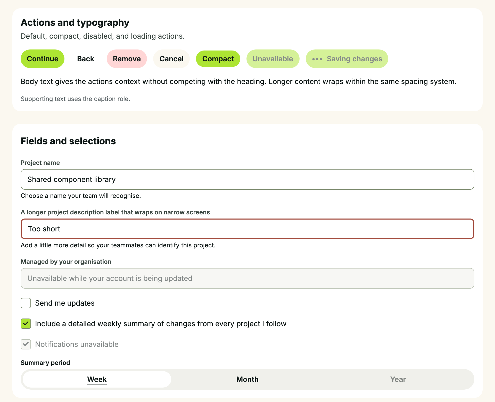

# pancake ui

a component library i can reach for whenever i want to build something. the buttons, forms, spacing, and everyday bits are already here, so i can get on with the app.

built with React, shared design tokens, and a familiar bit of lime green. light and dark, gentle motion, and it all works from the keyboard. bring your own ideas. pancakes optional.

<picture>
  <source media="(prefers-color-scheme: dark)" srcset="https://raw.githubusercontent.com/j4ckwinter/pancake-ui/main/docs/images/catalogue-dark.png">
  
</picture>

have a click around [the storybook](https://j4ckwinter.github.io/pancake-ui/). the theme button in its toolbar flips between light and dark.

## try it out

you’ll need a React 19.2+ app (within React 19), Node 22.18+, and an ESM bundler such as Vite. you don’t need Tailwind.

install the public package in your app:

```sh
npm install @jack.winter/pancake-ui
```

need a change that isn’t on npm yet? [installation and releases](docs/installation.md) covers installing a tested build straight from CI, local builds and upgrades.

## use it

import the styles once in your app entry point. the bundled Inter fonts are optional.

```tsx
import { Button, Stack, Surface, Text } from "@jack.winter/pancake-ui";
import "@jack.winter/pancake-ui/styles.css";
import "@jack.winter/pancake-ui/fonts.css";

export function Example() {
  return (
    <Surface>
      <Stack gap="space16">
        <Text as="h1" variant="title">
          Your next project
        </Text>
        <Text>Start with the useful bits already built.</Text>
        <Button>Get started</Button>
      </Stack>
    </Surface>
  );
}
```

your app owns routing, data, and validation. components take native props, refs, and your own content.

## what’s in the stack

| Area                    | Components                                                                                             |
| ----------------------- | ------------------------------------------------------------------------------------------------------ |
| Layout and typography   | `Stack`, `Inline`, `Text`, `Surface`                                                                   |
| Actions                 | `Button`, `ButtonLink`, `IconButton`                                                                   |
| Forms                   | `TextField`, `Textarea`, `Select`, `FileField`, `Checkbox`, `RadioGroup`, `Switch`, `SegmentedControl` |
| Navigation              | `AppHeader`, `SectionHeader`, `BottomNavigation`, `Tabs`, `Pagination`                                 |
| Overlays and disclosure | `Dialog`, `Popover`, `DropdownMenu`, `Tooltip`, `Disclosure`                                           |
| Data and identity       | `Table`, `Avatar`, `AvatarGroup`                                                                       |
| Feedback and progress   | `StatusChip`, `BannerToast`, `EmptyState`, `Progress`, `LoadingIndicator`, `StepProgress`              |

try them all in [the storybook](https://j4ckwinter.github.io/pancake-ui/), or look up the details in the [component reference](docs/components.md).

## make it yours

it’s light until you say otherwise. to follow the visitor’s system setting, put this on your root element:

```html
<html data-pancake-theme="system"></html>
```

use `dark` to stay dark. it works on any element too, so one panel can go dark on its own.

to change the colours, override the CSS variables in your app’s stylesheet, loaded after the library styles:

```css
:root {
  --color-pancake-accent: #b9e96f;
  --color-pancake-accent-hover: #d1f28a;
  --font-pancake: Inter, sans-serif;
}
```

set page layout and body styles in your app. see [theming](docs/installation.md#theming) for dark values, Tailwind integration and [styling](docs/styling.md) for the shared rules.

## work on it

from a local checkout:

```sh
npm ci
npm run storybook
```

`npm run example` opens the consuming app. before sharing changes, install the test browsers with `npx playwright install chromium firefox webkit`, then run `npm run verify`.

## a bit more

[installation and releases](docs/installation.md) · [component reference](docs/components.md) · [styling](docs/styling.md) · [verification](docs/verification.md) · [changelog](CHANGELOG.md)

code is licensed under [MIT](LICENSE). bundled Inter fonts retain their [SIL Open Font License](assets/fonts/OFL.txt).
